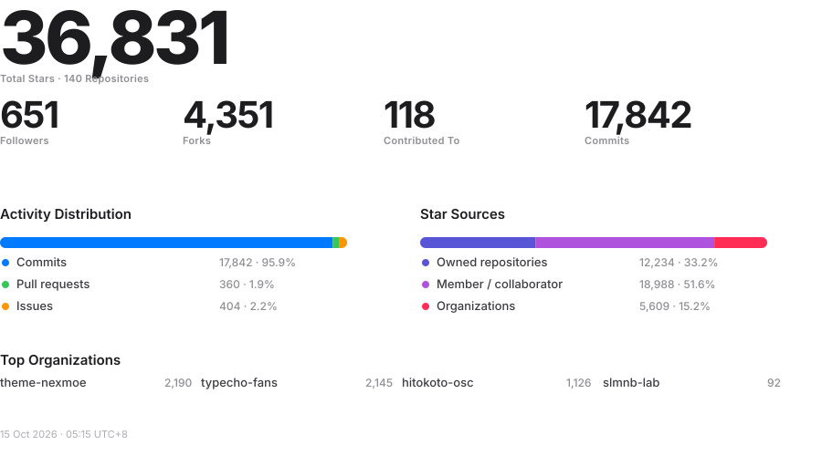

# Nexmoe

Open-source tools for video, audio, AI, and the web.

[Website](https://nexmoe.com) · [All projects](https://github.com/nexmoe?tab=repositories) · [Data notes](docs/README_DATA_METRICS.md)

## Overview

## Repositories

<!-- repo_rankings starts -->
### [Huanshere/VideoLingo](https://github.com/Huanshere/VideoLingo)

Netflix-level subtitle cutting, translation, alignment, and even dubbing - one-click fully automated AI video subtitle team | Netflix级字幕切割、翻译、对齐、甚至加上配音，一键全自动视频搬运AI字幕组

### [nexmoe/VidBee](https://github.com/nexmoe/VidBee)

Download video and audio from YouTube , TikTok , Twitter , Instagram , Facebook , Twitch , Bilibili , and 1000+ sites—or import local media. Create searchable transcripts on your computer, then summarize, translate, or ask questions with your preferred AI provider.

### [typecho-fans/plugins](https://github.com/typecho-fans/plugins)

Typecho Fans插件作品目录

### [nexmoe/DayBee](https://github.com/nexmoe/DayBee)

DayBee: A cross-platform long-running microphone recorder with real-time transcription. It uses Qwen3-ASR by default. VAD keeps only speech segments and transcribes speech-only chunks.

### [typecho-fans/themes](https://github.com/typecho-fans/themes)

Typecho Fans主题作品目录

### [nexmoe/vscode-monitor-pro](https://github.com/nexmoe/vscode-monitor-pro)

Monitor all the resources you care about. Be the coolest plugin.

### [void-sdk/void](https://github.com/void-sdk/void)

No description

### [nexmoe/serverless-comfyui](https://github.com/nexmoe/serverless-comfyui)

一个基于 Docker 的 ComfyUI 弹性 Serverless 应用，提供完整的前后端分离架构和用户友好的界面。
<!-- repo_rankings ends -->

---

Automatically refreshed every 6 hours · Last updated <!-- last_updated starts -->29 Oct 2026 · 12:17 UTC+8<!-- last_updated ends -->
>>>>>>> d7ca1a7 (Redesign README overview with Apple-inspired minimal UI)
