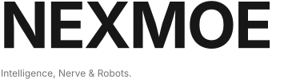
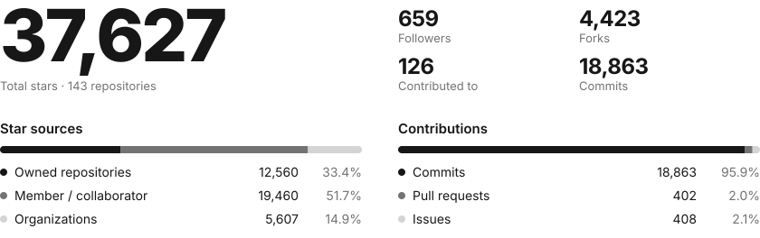

  
  <small><strong>English</strong> · <a href="./README.zh-CN.md">简体中文</a></small>
   

  &nbsp;
  

I'm Nexmoe, a Gen Z builder working across product, design, and engineering. I founded VidBee and BoTab, and co-founded Viora. I make tools for AI, video, and everyday productivity, with a goal of reaching a million users.

I also enjoy building farms, cities, and Dyson spheres — in games.

<!-- Repositories follow GitHub profile pins; repositories.json provides icons, descriptions, and screenshot overrides. -->
<!-- repositories starts -->

  

  

  

  

  

  

<!-- repositories ends -->

<!-- products starts -->

  

  

<!-- products ends -->

