

<a href="./README.md">English</a> · <strong>简体中文</strong>

<h1>Nexmoe</h1>

<strong>智慧、胆识与机器人。</strong>

我是 Nexmoe，一名 Z 世代 Builder，在产品、设计与开发之间切换。我创办了 VidBee 和 BoTab，也是 Viora 的联合创始人。我围绕 AI、视频与效率打造工具，希望让一百万人用上自己做的产品。

做产品之外，我也喜欢在游戏里种田、造城市、搭建戴森球。

  <a href="https://nexmoe.com">个人网站</a> &nbsp; │ &nbsp;
  <a href="https://x.com/nexmoe">X</a> &nbsp; │ &nbsp;
  <a href="https://github.com/nexmoe?tab=repositories">全部项目</a> &nbsp; │ &nbsp;
  <a href="./docs/README_DATA_METRICS.md">数据说明</a>

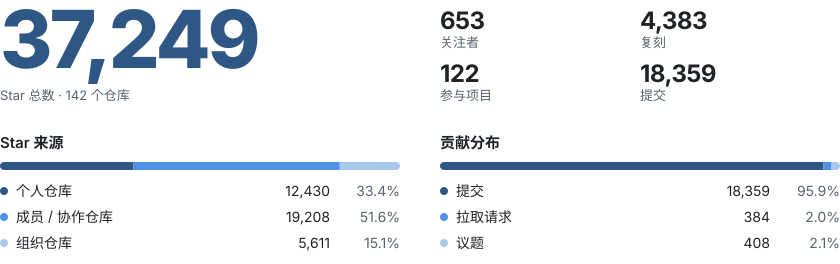

<!-- 项目选择、描述与顺序由 repositories.json 手动维护，不自动选取或排序。 -->
<!-- repositories starts -->

  
  <strong><a href="https://github.com/mikoagents/miko">Miko</a></strong> &nbsp; ★&nbsp;5 
  可自托管的 AI 编程助手。从团队协作工具接收任务，在独立的 Git 工作树中完成开发，并回报进度。

  
  <strong><a href="https://github.com/nexmoe/VidBee">VidBee</a></strong> &nbsp; ★&nbsp;11,025 
  从 1,000 多个网站下载视频和音频，转写、总结、翻译媒体内容，还能围绕内容与 AI 对话。

<table>
<tr><td nowrap>
  左右滑动或横向滚动，浏览全部功能截图 · 点击任意图片，即可查看原始尺寸的完整截图 
  <a href="https://github.com/nexmoe/VidBee/blob/main/screenshots/transcript-framed.webp">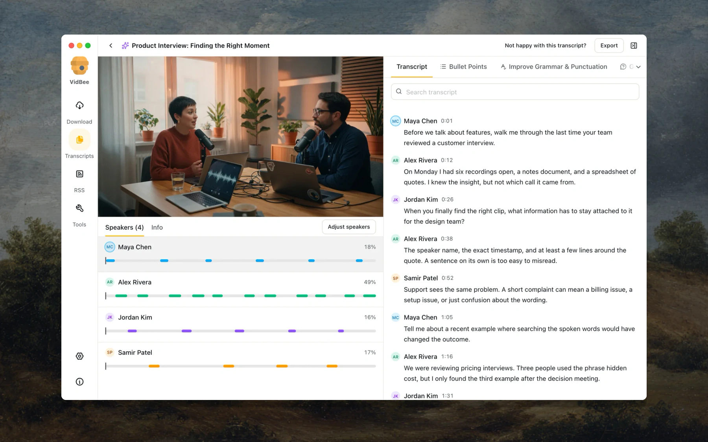</a>
  <a href="https://github.com/nexmoe/VidBee/blob/main/screenshots/ai-summary-framed.webp">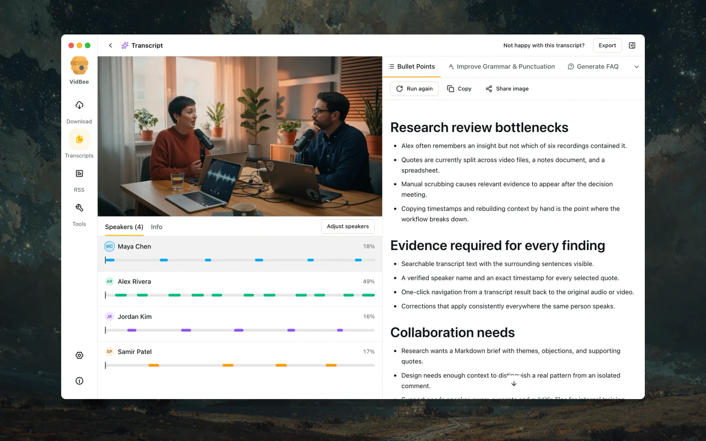</a>
  <a href="https://github.com/nexmoe/VidBee/blob/main/screenshots/downloads-framed.webp">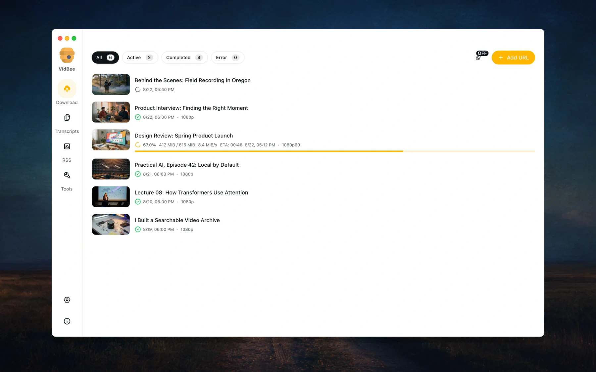</a>
  <a href="https://github.com/nexmoe/VidBee/blob/main/screenshots/rss-framed.webp">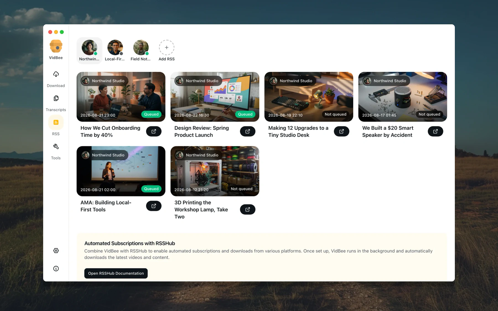</a>
  <a href="https://github.com/nexmoe/VidBee/blob/main/screenshots/v2-workflow-grid.webp">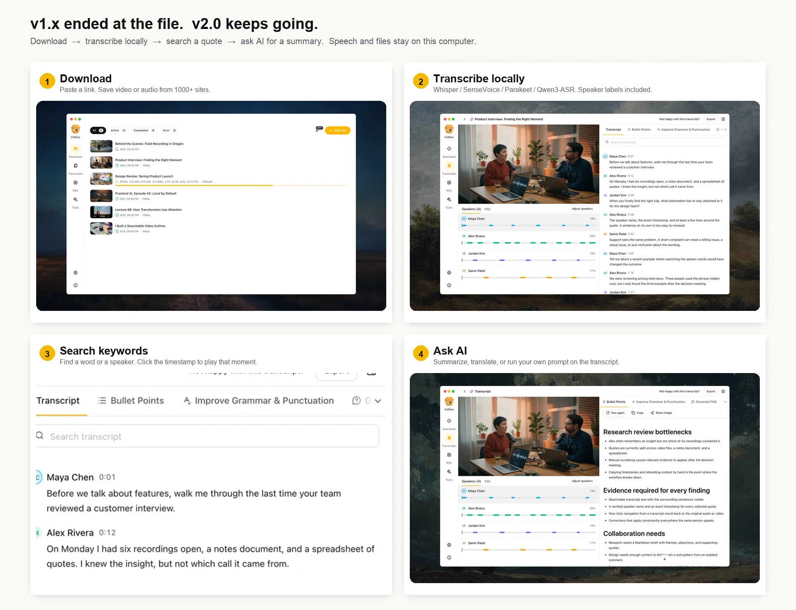</a>
  <a href="https://github.com/nexmoe/VidBee/blob/main/screenshots/v2-before-after.webp">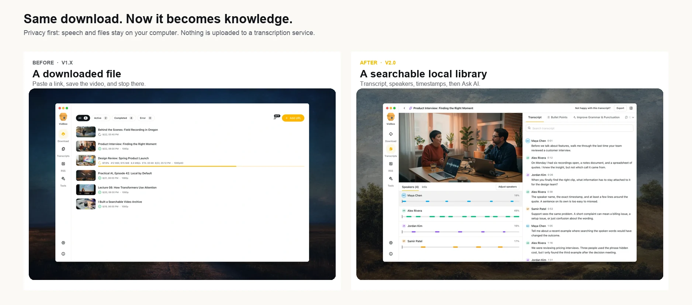</a>
</td></tr>
</table>

  
  <strong><a href="https://github.com/opentrends-io/opentrends">OpenTrends</a></strong> &nbsp; ★&nbsp;66 
  关注科技、AI 和开发者社区的一手信息，通过 AI 翻译与摘要跨越语言障碍。

  
  <strong><a href="https://github.com/nexmoe/DayBee">DayBee</a></strong> &nbsp; ★&nbsp;423 
  跨平台麦克风录音工具，支持实时转写和语音活动检测。

  
  <strong><a href="https://github.com/Huanshere/VideoLingo">VideoLingo</a></strong> &nbsp; ★&nbsp;19,011 
  一键完成 AI 字幕切分、翻译、对齐与配音。

  
  <strong><a href="https://github.com/nexmoe/vscode-monitor-pro">Monitor Pro</a></strong> &nbsp; ★&nbsp;222 
  直接在 Visual Studio Code 中监控你关心的系统资源。

<!-- repositories ends -->

  <strong><a href="https://botab.net">BoTab</a></strong> 
  Chrome 和 Edge 的标签页与书签管理工具。一键保存打开的标签页，用书签生成可自定义的新标签页；页面在本地生成，数据通过浏览器原生书签同步。

<table>
<tr><td nowrap>
  左右滑动或横向滚动，浏览全部功能截图 · 点击任意图片，即可查看原始尺寸的完整截图 
  <a href="https://botab.net/images/home/scrnli_03znv9dx23edPR.png">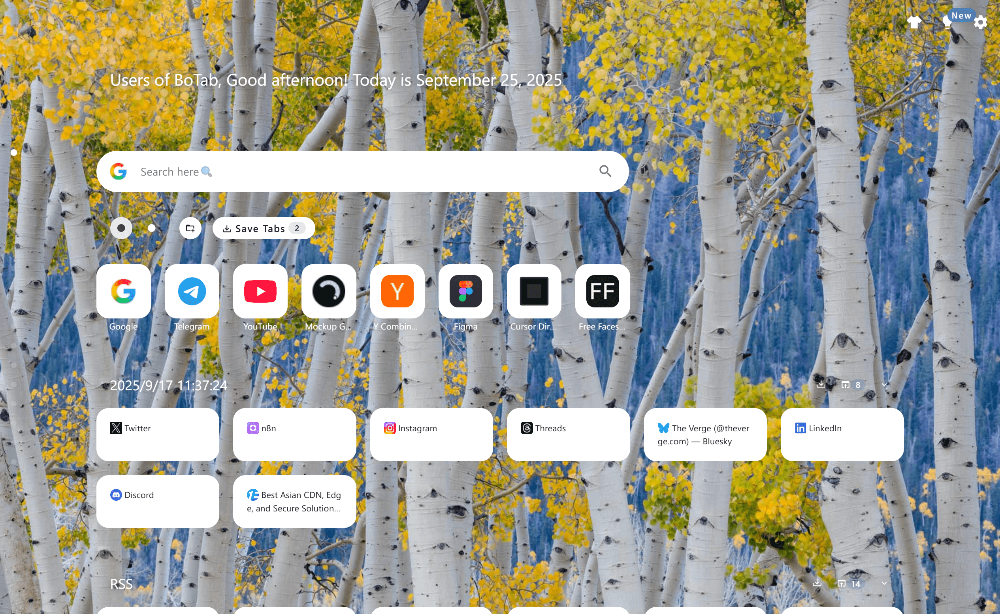</a>
  <a href="https://botab.net/images/screenshot/image5.png">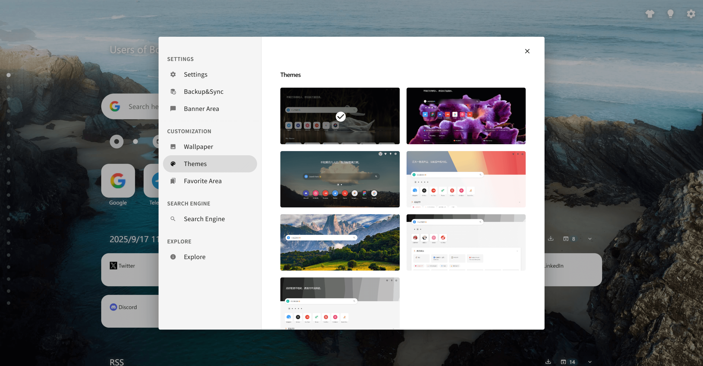</a>
</td></tr>
</table>

  <strong><a href="https://viora.io/">Viora</a></strong> 
  macOS 语音 AI 助手。按住快捷键说话，即可在当前应用中输入、改写选中文字、结合上下文提问，或交办任务。

<table>
<tr><td nowrap>
  左右滑动或横向滚动，浏览全部功能截图 · 点击任意图片，即可查看原始尺寸的完整截图 
  <a href="https://viora.io/images/viora/features/viora-dictation-tutorial.png">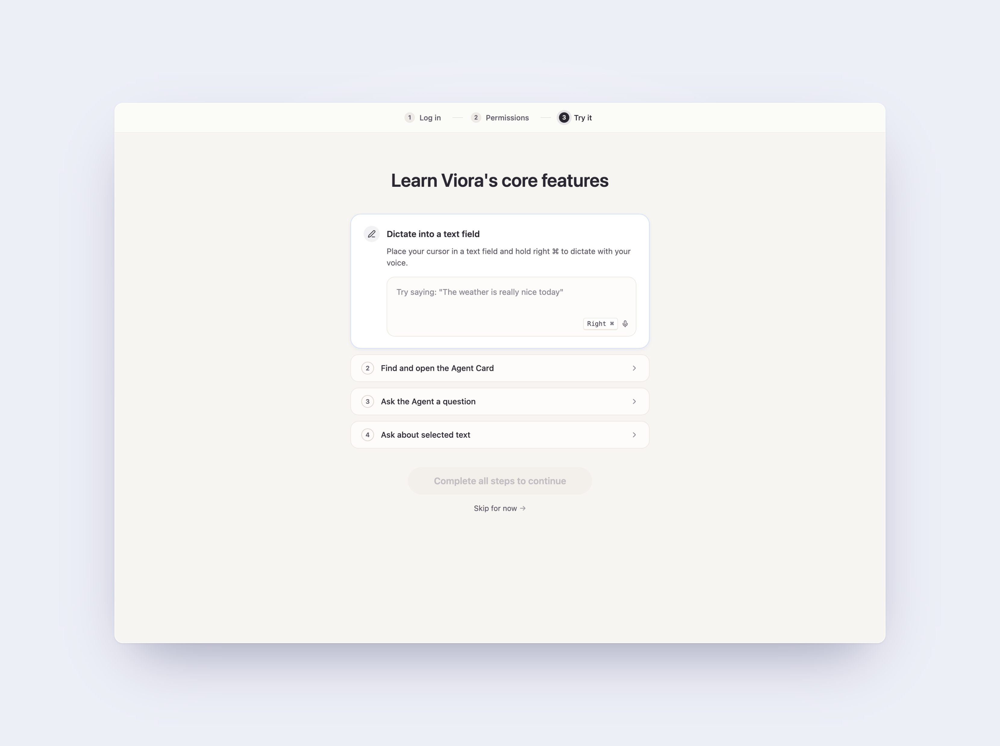</a>
  <a href="https://viora.io/images/viora/features/viora-capsule-email-reply.png">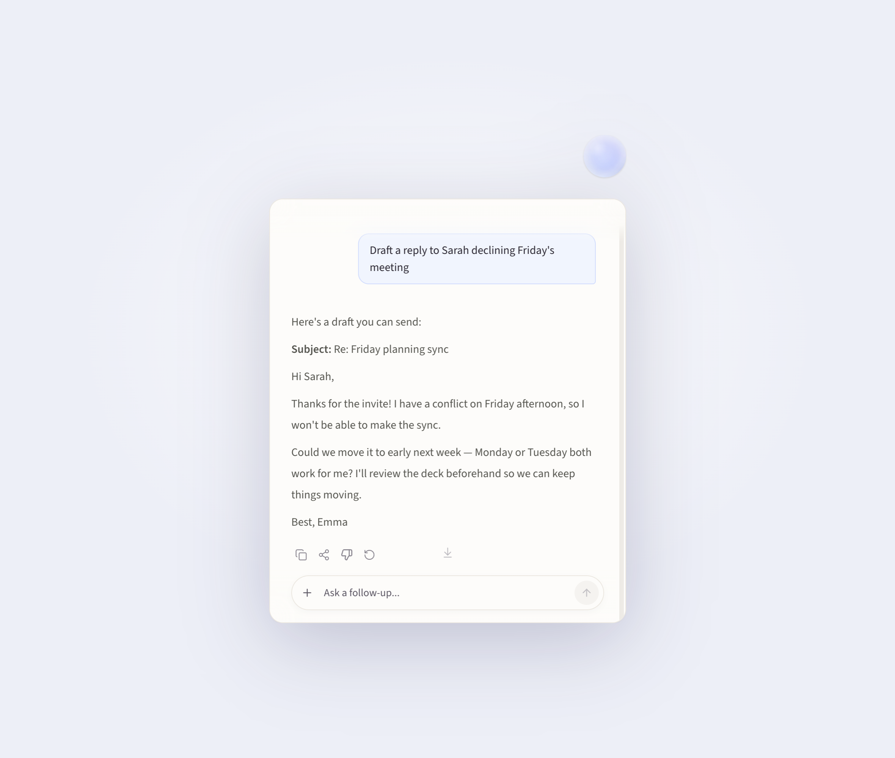</a>
  <a href="https://viora.io/images/viora/features/viora-capsule-comparison-table.png">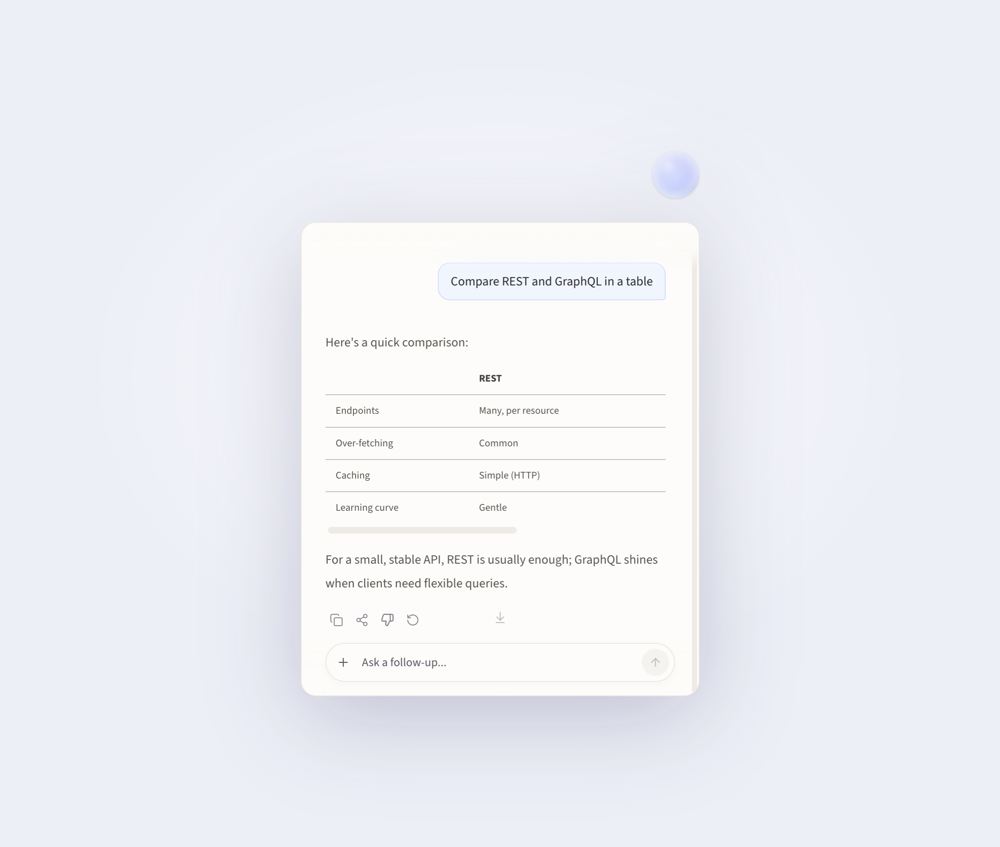</a>
</td></tr>
</table>

