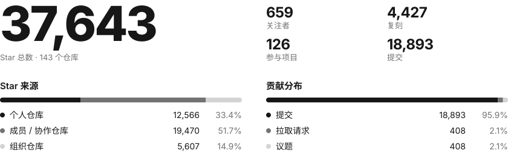

  
  <small><a href="./README.md">English</a> · <strong>简体中文</strong></small>
   

  &nbsp;
  

我是 Nexmoe，一名 Z 世代 Builder，在产品、设计与开发之间切换。我创办了 VidBee 和 BoTab，也是 Viora 的联合创始人。我围绕 AI、视频与效率打造工具，希望让一百万人用上自己做的产品。

做产品之外，我也喜欢在游戏里种田、造城市、搭建戴森球。

<!-- 项目与顺序跟随 GitHub 置顶；repositories.json 提供图标、介绍与截图覆盖。 -->
<!-- repositories starts -->

  

  

  

  

  

  

<!-- repositories ends -->

<!-- products starts -->

  

  

<!-- products ends -->

